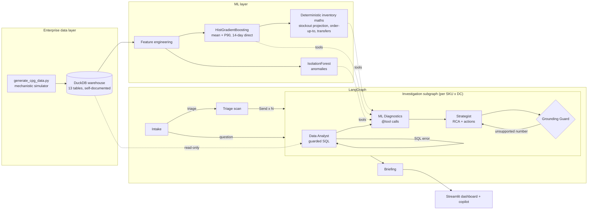

# CPG Pulse: Autonomous Supply Chain & Retail Demand Intelligence

A portfolio project for FMCG supply-chain analytics. It is built around one question a planner asks every morning:
*which SKUs are about to run out (or pile up) at which distribution centre, why, and what do we do about it?*

CPG Pulse puts four layers behind that question:

| Layer | Tech | What it does |
|---|---|---|
| Enterprise data | DuckDB, pandas | Two years of simulated daily sell-out, inventory, POs, promos and disruptions for 14 SKUs x 4 Romanian DCs |
| Machine learning | scikit-learn | 14-day demand forecaster (HistGradientBoosting) + velocity/inventory anomaly detector (IsolationForest) |
| Agentic workflow | LangGraph | Data Analyst -> ML Diagnostics -> Supply Chain Strategist -> Grounding Guard, fanned out in parallel for morning triage |
| Presentation | Streamlit, Plotly | KPI & ML dashboard, live agent copilot with step-by-step trace, model & SQL lab |

> All data is synthetic. Brand names (Ariel, Pampers, Gillette ...) only illustrate a realistic category
> structure; no figures relate to any real company.

---

## Quick start

```bash
cd cpg-pulse-agent
python -m venv .venv
.venv\Scripts\activate            # macOS/Linux: source .venv/bin/activate
pip install -r requirements.txt

python data/generate_cpg_data.py  # ~20 s  -> data/cpg_warehouse.duckdb
python -m src.ml_pipeline         # ~2 min -> models/*.joblib + models/model_card.json
streamlit run app.py
```

The app also builds the warehouse and trains the models on first launch if they are missing.

**LLM is optional.** Copy `.env.example` to `.env` and set `LLM_PROVIDER` plus a key (OpenAI, Groq) or run Ollama
locally. Without a key the agents run in **deterministic mode**: the same SQL, models and maths, with a rule-based
narrative instead of an LLM-written one. That way the demo works offline and in an interview.

CLI and tests:

```bash
python -m src.agents.graph "Why is Ariel Pods 40ct at risk of stocking out in Bucharest next week?"
python -m src.agents.graph          # no question = autonomous morning triage
pytest                              # 24 tests, ~7 s
```

---

## Architecture



### The investigation subgraph

| Node | Uses an LLM? | What it does |
|---|---|---|
| **Intake** | No | Resolves "Ariel Pods 40ct in Bucharest" to `FC-ARL-PODS40 @ DC-BUC` deterministically. Routes to investigation, text-to-SQL, triage or clarification. |
| **Data Analyst** | Only for ad-hoc questions | Runs a parameterised SQL playbook (demand trend, inventory position, open POs, promo calendar, disruptions, network stock, competitor pricing). For free-form questions it writes SQL from the warehouse's own schema comments and **self-corrects** on errors, up to 3 attempts. |
| **ML Diagnostics** | No | Calls the `@tool`s: forecast, stockout projection, anomaly scan, replenishment recommendation. It also pre-computes every comparison the narrative might need (week-over-week change, forecast vs policy) so the LLM can quote figures instead of calculating them. |
| **Supply Chain Strategist** | Yes (or rule-based) | Writes a Pydantic-validated `ExecutiveBrief`: headline, root causes with evidence, typed actions (PO / transfer / expedite / promo / policy), risk and confidence. |
| **Grounding Guard** | No | Extracts every number and date from the brief and checks each against the tool evidence. If any is unsupported it sends the draft back with the offending values. A second failure swaps in the deterministic brief. **The LLM cannot publish an invented number.** |

Morning triage scans all 56 SKU x DC series, then uses LangGraph `Send` to run the investigation subgraph in
parallel for the top risks. It always includes one overstock case, so the briefing covers both sides of the
working-capital trade-off.

---

## Results (seed 42, as-of 2026-10-31)

**Demand forecaster** (backtest: last 56 forecast origins x 14 horizons, 38k predictions, trained only on data before the window)

| Model | WAPE |
|---|---|
| Seasonal naive (same weekday last week) | 40.0% |
| 28-day moving average | 31.9% |
| **HistGradientBoosting (global, direct multi-horizon)** | **26.9%** (33% better than seasonal naive) |

Bias -0.1%, WAPE on promo days 26.1%, P90 interval coverage 86.5% (target 90%). Accuracy is flat across the
14-day horizon because the main drivers (promo calendar, weekday, season) are known in advance.

**Anomaly detector**: 78 flags in two years of data, catching 80% of the anomalies the generator injected
(84% of velocity spikes, 73% of inventory drops). Precision against the injected set is 41%. Most of the other
flags are real extremes (post-stockout rebounds, price-war weeks), so 41% is a lower bound.

**What the agents find:** without being told, they surface the scenarios the generator planted:

| Case | Agent diagnosis |
|---|---|
| Ariel Pods 40ct @ Bucharest | Stockout in 2 days, and no PO can land before day 11. Causes: demand +52% (viral spike), 30%-off promo in 4 days, PVA-film disruption adding 7 days of lead time, late inbound PO, stale reorder point. Actions: PO for 2,214 units (369 cases), expedite, phase the promo, raise the reorder point. |
| Pampers Active Baby @ Cluj | Overstocked with 34 days of cover. Causes: cancelled multibuy after pre-build landed; competitor price index -18.5%. Action: hold replenishment, offer excess to at-risk DCs (Iasi gets a 40-unit transfer option). |
| Head & Shoulders @ Bucharest | Bulk B2B order spike flagged by IsolationForest; stockout in 3 days. |
| Gillette Fusion5 @ Timisoara | Unexplained inventory drop (pallet damage) flagged; stockout in 3 days. |

---

## Design decisions worth discussing

1. **Forecast unconstrained demand, not sales.** When a DC is out of stock, sales read zero even though people
   still wanted the product. A model trained on `units_sold` learns that stockouts mean low demand and
   under-forecasts the next cycle. The simulator records lost sales so the target is `units_demanded`.
2. **One global model, scale-normalised.** Targets and lag features are divided by each series' trailing
   28-day mean, so a 20-unit/day razor and a 130-unit/day dish soap share one model. Categorical SKU, DC and
   category codes let it learn series-specific effects.
3. **Direct multi-horizon instead of recursive.** Each row is (origin, horizon h): no error compounding, and
   future promo depth enters as a known-in-advance feature. That is how the model anticipates a planned leaflet.
4. **P90 via quantile loss.** The second model drives safety stock (sigma derived from the P90-mean spread) and
   the pessimistic stockout date.
5. **Lead-time-aware risk.** "Runs out in 5 days" means nothing on its own. The triage asks whether stock runs
   out *before a PO raised today can land*, with lead time extended by active disruptions. Only that gap is
   lost revenue, and only that gap justifies a transfer or expedite.
6. **Promo-adjusted anomaly features.** A 2.5x spike on a 30%-off day is expected. IsolationForest scores
   velocity *after* dividing out a per-SKU fitted promo elasticity, plus the unexplained inventory residual
   `close - (open + receipts - shipped)`. Cutting six correlated features to these two raised recall from 50% to 80%.
7. **Defence in depth for LLM SQL.** DuckDB opens the file `read_only` with external access disabled and config
   locked. Queries pass DuckDB's own parser (single `SELECT` only), a keyword/table-function deny list, a row
   cap and a timeout.
8. **LLM for language, code for numbers.** Every figure comes from SQL or `ml_pipeline`. The Grounding Guard
   enforces this mechanically instead of trusting a prompt.

---

## Repository layout

```text
cpg-pulse-agent/
├── .env.example
├── requirements.txt
├── README.md
├── app.py                         # Streamlit: dashboard, copilot, model & data lab
├── data/
│   └── generate_cpg_data.py       # mechanistic FMCG simulator -> cpg_warehouse.duckdb
├── src/
│   ├── db.py                      # read-only DuckDB manager + SQL guard + schema from COMMENTs
│   ├── ml_pipeline.py             # features, HGB forecaster, IsolationForest, stockout/replenishment maths, triage
│   ├── tools.py                   # LangChain @tools, entity resolver, SQL playbook, analytics templates
│   └── agents/
│       ├── state.py               # AgentState / CaseState TypedDicts + Pydantic output contracts
│       └── graph.py               # nodes, routing, Send fan-out, grounding guard, LLM factory
└── tests/
    └── test_pipeline.py           # guard, maths, scenarios, graph (deterministic + scripted-LLM paths)
```

### Warehouse tables

`dim_sku`, `dim_dc`, `dim_supplier`, `dim_inventory_policy`, `dim_transfer_lanes`, `fact_daily_sales`,
`fact_inventory_daily`, `fact_purchase_orders`, `fact_promo_calendar`, `fact_logistics_disruptions`,
`fact_channel_sales_weekly`, `meta_dataset_info`, `meta_injected_anomalies`. Every table and key column carries a
DuckDB `COMMENT`; the text-to-SQL agent reads its schema from those comments at runtime.

---

## Limitations & next steps

- The data is simulated. On real data the first job would be demand-sensing for lost sales, because true
  `units_demanded` is not observed and needs a censored-demand model.
- The forecaster's P90 slightly under-covers (86.5% vs 90%). Conformal calibration on the backtest residuals
  would fix this cheaply.
- Replenishment is single-echelon (s, S) logic. A multi-echelon optimiser (e.g. OR-Tools) could jointly decide POs
  and transfers under truck capacity.
- Agent memory: a LangGraph checkpointer would let planners follow up ("and what if the promo moves a week?")
  on the same case.
- Tested with Python 3.11, DuckDB 2.0, pandas 3.1, scikit-learn 1.9, LangGraph 1.2, Streamlit 1.66.
